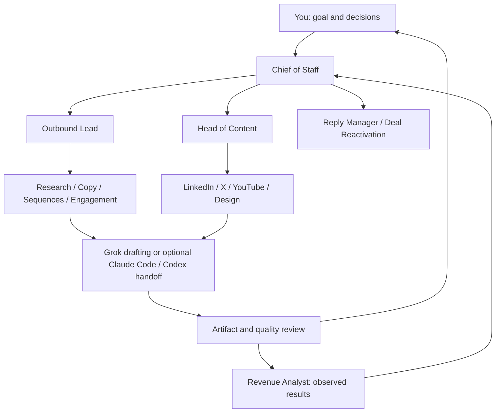

# Grok Bot GTM Team

**15 Grok Bots for outbound, content and follow-ups—with a Chief of Staff to coordinate the work and bring it back for your review.**

Built by **Aditya Chouhan**. Start with five Bots for one lane, or configure the full team. Grok Bot handles coordination; Claude Code or Codex can handle execution through your chosen handoff.

**[Set up your team →](setup-prompt.md)** · [Meet the Bots](#meet-the-team) · [How it works](#how-the-work-moves) · [Try a first job](examples/first-job.md)

## One goal. Clear owners. Work you can review.

Give the team a concrete job: research a set of accounts, prepare a discovery sequence, turn an idea into content, or revisit a stalled conversation.

The lead assigns the work. Specialists produce the research, drafts and assets. A reviewer checks the evidence. Chief of Staff brings back the result, the missing information and the decision that needs you.

Every handoff carries the outcome, inputs and limits. You can see who owns the next step and what actually came back.

## Set up in Grok Bot

1. Create a Bot called **Chief of Staff**.
2. Copy the complete [team import bundle](dist/grok-team-import.txt) and paste it into its chat.
3. Answer the questions about your company, audience, tools, context files and preferred execution route.
4. Choose a starter team or the full roster. Inspect the setup receipt and finish any steps the app requires you to do manually.

The bundle includes the Bot instructions, so repository-browsing access is optional. If your client cannot accept the whole message, use the [manual setup route](setup-prompt.md).

Nothing is sent or spent during setup. Routines stay off until you choose one.

### Choose where to start

| Team | Included Bots | First useful job |
|---|---|---|
| **Outbound starter** | Chief of Staff, Outbound Lead, Lead Sourcer, Outbound Copywriter, Quality Reviewer | Research an audience and prepare a grounded outreach draft |
| **Content starter** | Chief of Staff, Head of Content, LinkedIn Writer, Graphic Designer, Quality Reviewer | Turn a supported idea into a post and visual brief |
| **Full team** | All 15 Bots | Coordinate outbound, content, conversations and measurement |

## Meet the team

Each linked file contains the complete instructions to paste into that Bot.

### Coordination and review

| Bot | Owns | Reports to |
|---|---|---|
| [Chief of Staff](agents/01-chief-of-staff.md) | Priorities, routing, execution handoffs and the review queue | You |
| [Quality Reviewer](agents/15-quality-reviewer.md) | Evidence checks, unsupported claims and revision requests | Chief of Staff |
| [Revenue Analyst](agents/16-revenue-analyst.md) | Results readouts, measurement limits and next experiments | Chief of Staff |

### Outbound

| Bot | Owns | Reports to |
|---|---|---|
| [Outbound Lead](agents/02-outbound-lead.md) | Campaign contracts, assignments and readiness decisions | Chief of Staff |
| [Lead Sourcer](agents/03-lead-sourcer.md) | Cold and warm account research, qualification and list preparation | Outbound Lead |
| [Outbound Copywriter](agents/04-outbound-copywriter.md) | Email and LinkedIn first touches and follow-ups | Outbound Lead |
| [Sequences & Deliverability](agents/05-sequences-deliverability.md) | Sequence preparation and sender/campaign health | Outbound Lead |
| [Social Engagement](agents/06-social-engagement.md) | Creator research, engagement queues and comment drafts | Outbound Lead |

### Conversations

| Bot | Owns | Reports to |
|---|---|---|
| [Reply Manager](agents/07-reply-manager.md) | Existing-thread triage and reply drafts | You; coordinates with Outbound Lead |
| [Deal Reactivation](agents/08-deal-reactivation.md) | Prior sales conversations and relevant follow-up drafts | You |

### Content

| Bot | Owns | Reports to |
|---|---|---|
| [Head of Content](agents/09-head-of-content.md) | Editorial planning, briefs and assignments | Chief of Staff |
| [LinkedIn Writer](agents/10-linkedin-writer.md) | LinkedIn posts, hooks and articles | Head of Content |
| [X Writer](agents/11-x-writer.md) | X posts, threads and articles | Head of Content |
| [YouTube Writer](agents/12-youtube-writer.md) | Titles, scripts and packaging | Head of Content |
| [Graphic Designer](agents/13-graphic-designer.md) | Social graphics, thumbnails and editable visual assets | Head of Content |

The optional **Outbound Room** and **Content Room** keep selected teammates together. Rooms carry short pointers; drafts and source material live in your chosen workspace.

## How the work moves

### Example: research to an outreach draft

You provide an offer, an ICP and a small set of account facts. Outbound Lead defines the job; Lead Sourcer explains which accounts fit and what remains unknown. Outbound Copywriter uses that evidence to draft a message. Quality Reviewer checks the claims. Chief of Staff returns the draft and its blockers.

The result is an **unsent draft with supporting evidence**. Sending is a separate decision. The [first-job prompt](examples/first-job.md) lets you try this flow using fictional data and no paid tools.

## What this edition adds

- **Smaller starting teams.** Configure one useful lane before adding every channel.
- **A complete import bundle.** Setup and role instructions travel together.
- **Setup that handles missing capabilities.** Unsupported creation steps become explicit manual steps; reruns inspect existing Bots and rooms before creating duplicates.
- **Dedicated quality and measurement roles.** Check the draft before acting, then distinguish observed outcomes from assumptions.
- **Clear work and review records.** Capture the owner, source revision, limits, returned artifact and next decision.
- **Recovery rules.** Check an uncertain external outcome before retrying a send, publication or purchase.

These are coordination instructions. They do not create technical access isolation or automatically detect changed files.

## What you need

- **A Grok Bot account.** Available creation, room and connector capabilities depend on your account/session. Manual setup is supported.
- **Your company context.** Product facts, audience, voice examples and proof the team may use.
- **Your chosen GTM tools, when needed.** Supplied files are enough for a draft-only first job. Live research, sequences and inbox work need compatible tools you authorize.
- **Claude Code or Codex, optionally.** Use a manual handoff or an already authorized execution route. The kit does not install or authenticate either assistant.

The [operating templates](templates/operations.md) cover company context, connector scope, work packets, review receipts and setup receipts. No local CLI or Python installation is required to use the Bots.

## Validation status

**The kit has not yet been provisioned or behaviorally tested inside Grok.** The [live validation checklist](guides/grok-validation.md) covers the in-app checks still to perform. Examples illustrate intended behavior; they are not captured runs or revenue results.

Maintainers can run `python3 scripts/validate.py` to check the roster, self-contained instructions, bundle coverage and local links. These structural checks do not prove model behavior.

## Credit and license

Adapted and extended by **Aditya Chouhan** from Tim Scheuer's MIT-licensed [Grok Bot GTM team](https://github.com/timscheuerai/grokbot-gtm-team). This edition retains and adapts the original roles and adds setup presets, shared operating rules, quality review and measurement roles.

[MIT license](LICENSE) · [Upstream attribution](THIRD_PARTY_NOTICES.md)
